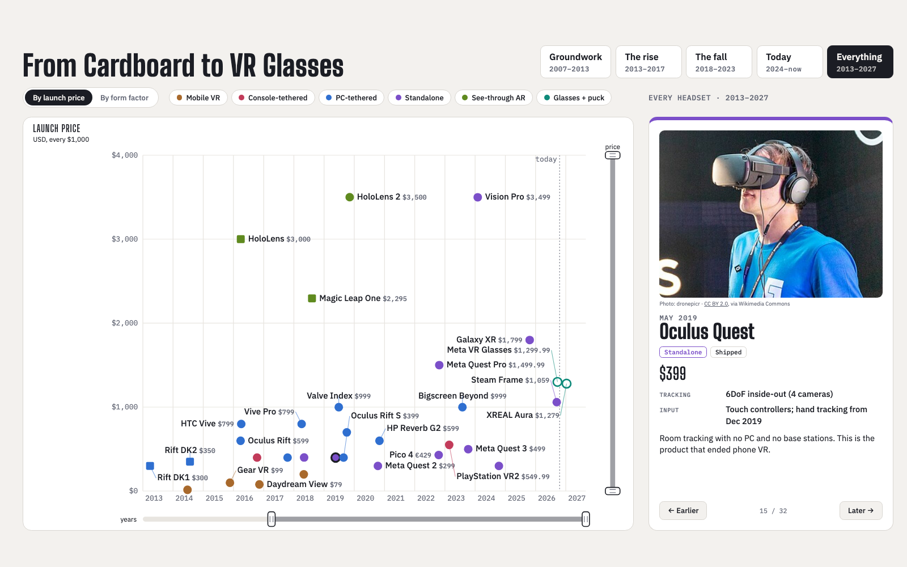
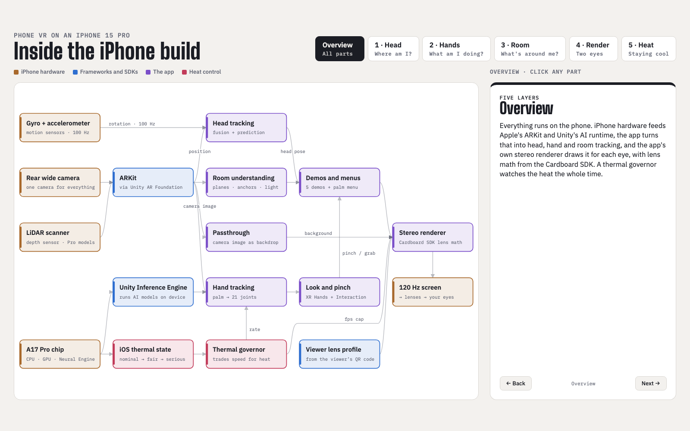

# CardboardXR

A Unity phone app for Google Cardboard-style viewers: split-screen stereo with lens distortion,
plus what classic Cardboard never had — 6DoF head tracking from ARCore or ARKit, a camera
passthrough view, detected surfaces with anchored objects, and hand tracking from the phone's rear
camera with pinch, grab and a pointing ray.

Tested on a **Pixel 9 Pro** (Android, ARCore) and an **iPhone 15 Pro** (iOS, ARKit, with LiDAR).

## Video and viewer

**Watch the video** about the project on YouTube:

[](https://youtu.be/XtNmiTohUcs)

**Print the viewer**: the 3D print files for a mobile VR viewer made for modern smartphones are on
MakerWorld: [Mobile VR viewer for modern smartphones](https://makerworld.com/en/models/3511377-mobile-vr-viewer-for-modern-smartphones).

## Interactive pages

Two interactive pages go with the project. Click an image to open it.

**From Cardboard to VR glasses**: every headset since 2013, by launch price or form factor, and
where phone VR fell away.

[](https://brenpoly.github.io/CardboardXR/)

**Inside the iPhone build**: how the hardware, Apple's and Unity's frameworks and the app fit
together, layer by layer.

[](https://brenpoly.github.io/CardboardXR/iphone-architecture.html)

The pages are in `docs/`, served by GitHub Pages.

## Requirements

- Unity **6000.6.0f1** with the Android and iOS build modules. The scripts expect it where Unity
  Hub puts it; for another location, set `UNITY=/path/to/Unity.app/Contents/MacOS/Unity`
- For Android: `adb` on your `PATH` (it's in `~/Library/Android/sdk/platform-tools`)
- For iOS: full Xcode, signed into an Apple ID (a free personal team is enough)

Close the project in the Editor before running any script: they build in batch mode, which needs
the project lock.

## Build and run

Each script builds the app, installs it, launches it and prints the start of the
session log.

```sh
zsh Tools/build_and_run.sh                                   # Android
zsh Tools/ios_build_and_run.sh                               # iOS
zsh Tools/ios_build_and_run.sh --xcode                       # iOS, reusing the last Unity export
zsh Tools/ios_launch.sh                                      # iOS, relaunch without rebuilding
```

Builds are release builds. For a development build (debuggable, with the Unity Profiler able to
connect over the local network), set `CARDBOARDXR_DEVELOPMENT=1`. The app id is
`com.brenpoly.cardboardxr`; an iOS bundle id belongs to the Apple team that first signed it, so to
build for your own iPhone pick your own, the same way for every script:

```sh
CARDBOARDXR_BUNDLE_ID=com.example.cardboardxr zsh Tools/ios_build_and_run.sh
```

The Android script also runs the EditMode tests first. On iOS, the first install needs Developer
Mode on the phone (Settings > Privacy & Security, which only appears after a first install attempt)
and trusting the developer (Settings > General > VPN & Device Management). The phone must be
unlocked to launch; a build takes about five minutes, so if it auto-locks in the meantime, unlock
it and run `ios_launch.sh`.

### Launch options

Development overrides, given the same way on both platforms after the script's own arguments:

```sh
zsh Tools/build_and_run.sh --ei dof 3 --ei mono 1
zsh Tools/ios_launch.sh --ei dof 3 --ei mono 1
```

On Android they're intent extras; on iOS they reach the app as environment variables
(`CARDBOARDXR_<name>`). Either way they only apply to a launch from the Mac, not one from the
phone's home screen. The app logs the options it received at startup (`[Stereo] Launch options`).

| Option | Effect |
|---|---|
| `demo N` | Start in demo N (its index in `Assets/_Project/Demos/DemoCatalog.asset`, from 0) instead of the lobby |
| `pinch 0` | Pinch-to-click off in 3DoF, for measuring its heat (it's otherwise always on) |
| `dof 3` | Start the lobby in 3DoF, with no room scan (it starts in 6DoF passthrough otherwise) |
| `passthrough 1` | Start with the camera passthrough view |
| `mono 1` | One full-screen view with no lens distortion, for use without a viewer |
| `boundaryCm N` | Turn on the boundary warning: in VR, a grid on real surfaces within N cm |
| `arView 1` | Debug view: the AR camera full screen with every detected surface drawn (forces 6DoF) |
| `fps N` | Target frame rate (default 120) |
| `renderScale N` | Eye texture resolution in percent (default 100) |
| `msaa N` | Anti-aliasing samples: 1, 2, 4 or 8 (default 2) |
| `handHz N` | Run the hand landmark model at most N times a second (default 0: every camera image) |
| `predictionMs N` | How far ahead head rotation is predicted, in ms (default 30) |
| `tracker 1` | Head rotation from Android's game rotation vector instead of the app's own sensor fusion |
| `nativeImu 0` | Android: read the sensors through the Input System instead of the native plugin |
| `imuPosition 0` | Leave the accelerometer out of 6DoF position, for comparison |
| `handAxes 1..8` | Override how the camera image's axes lie on screen, for hand tracking |
| `pinchStudy 1` | A prompted run that logs pinch measurements, for tuning pinch detection |
| `uiScale N` | Size of the Material UI in percent of Android XR's dp sizes (default 160, for phone viewers' lower resolution) |
| `brightness N` | Screen brightness while the app is in front, in percent (default 90; 0 leaves it alone) |

## Using the app

- **The screen's gear button**, top right, opens a small menu: *Set viewer* scans a viewer's QR
  code; *Phone view* / *Viewer view* switches between the viewer's split-screen view and a single
  full-screen phone view; *Open settings* opens the settings panel.
- **The app library**, above the settings panel, has an icon for the lobby and each demo: look at
  one to see what it is, and pinch or tap to open it, from anywhere, so you can go straight from one
  demo to another. *Apps* on the settings panel shows and hides it. The lobby is a checkerboard room
  to start from, and opens with the library showing. As the app starts, the lobby is in 6DoF
  passthrough and first scans your room: look around at the floor and any tables until it says it's
  done (or tap *Skip*), so the demos start with tracking running and surfaces found. Each demo switches on what it needs (6DoF,
  passthrough, hands) and leaving puts back what you had.
- **Input is gaze and pinch everywhere**: look at something and pinch in front of the camera to
  click it. A screen tap works too. The reticle turns light blue while the camera sees your hand.
  In 6DoF demos, hand tracking does it (and picks things up); in 3DoF, a lighter detector that only
  watches for pinches, from a plain camera feed, and slows down while no hand is in view.
  Every pinch goes through one order (`PinchRouter`): the palm's settings gear, then a button under
  the gaze, then the demo's own use (painting, hitting orbs), then picking up, then a plain click.
  If you rest your gaze on a button with no hand in the camera's view, a hint under the reticle says
  to raise it.
- **360 Video** plays 360 and VR180 videos, 2D or 3D. Pinch on the video for the controls. Two
  small test clips are bundled. To bundle your own in local builds, put them in a `360` folder
  beside the project (or set `CARDBOARDXR_VIDEOS`): the build scripts copy them into
  `Assets/StreamingAssets`, which git ignores apart from the test clips. Or add your own to the app's `Videos` folder on the phone: on
  Android `adb push video.mp4 /storage/emulated/0/Android/data/com.brenpoly.cardboardxr/files/Videos`;
  on iPhone, Finder's Files tab for the phone, then CardboardXR > Videos. Tags in the name set the
  format (`_360`, `_180`, `_sbs`, `_tb`, `_mono`). For Google Drive, put share links in
  `videos.txt` in that folder, one per line; each downloads on first play.
- **Air Paint** paints strokes in the air with your hand, like Tilt Brush, starting in passthrough
  so you paint in your own room: pinch to paint, and look at the tool panel on your left and pinch
  to pick a color, brush (Ink, Tube, Glow) and size, or to undo, reset (press twice), or switch
  between passthrough and VR.
- **Orb Rush** is a one-handed game: orbs fly toward you and you hit them with your
  hand as they reach their rings. Face the way you want to play and press Start; Pause (on the
  score line above the track) resumes, restarts or quits a round. The best score is kept.
- **Portal** opens a doorway on your floor (look at it and pinch) with a night world beyond it.
  Walk through the frame, off the cable, and the world surrounds you, with your room showing
  through the door behind; walk back through to return. It's in passthrough, so all of it is flat.
- **The settings panel**, in every scene: hold a hand up with its palm toward you and a gear button
  appears between your thumb and index finger; pinch to open the panel in front of you. It has
  *Apps* (the app library), *Recenter* and *Scan Room* (in 6DoF: scans again, or ends a scan), and the toggles *6DoF* and *Passthrough*. It follows
  you lazily as you turn; the *X* below it closes it. Look at a button and tap the screen, or
  pinch. Holding a tap recenters.
- **Surfaces** are found by the lobby's scan at launch, which runs until it finds nothing new. When
  6DoF starts again later (after the 360 Video, say) a shorter scan runs until the floor is found,
  to save CPU for the hand models; the Cube Sandbox scans the whole room if the lobby's didn't.
- **Placing and moving objects**: in 6DoF, look at a surface and tap or pinch to place a cube,
  which is anchored there. Your head aims and a pinch clicks; your hand, or its ray, picks cubes
  up. A cube turns cyan when a pinch would grab it. Held, it turns with your hand and knocks other
  cubes aside; open your fingers to let go or throw it. Free cubes have physics: they fall, bounce
  off each other and land on detected surfaces. If the camera loses your hand while you hold one,
  it stays where it was rather than dropping.

## Logs

Every launch writes a session log on the phone, replacing the last one (which is kept as
`session-previous.log`). The scripts print its start; to read the whole thing:

```sh
adb pull /storage/emulated/0/Android/data/com.brenpoly.cardboardxr/files/session.log   # Android
```

On iOS, `ios_launch.sh` copies it to `$TMPDIR/cardboardxr/ios-session.log`.

Lines are tagged by area: `[Pose]` head tracking, `[AR]` the AR session, `[Room]` surfaces and the
floor, `[Anchor]` placed objects, `[Hands]` hand tracking and grabs, `[Pinch]` the pinch study,
`[Passthrough]`, `[Gaze]` clicks, `[Frames]` and `[Hitch]` frame timing, `[Stereo]` setup, and
`[Tracking]` the motion sensors. Most areas log a status line every five seconds. Warnings and
errors are always kept.

## Recording clips

To film what one eye sees, without the lens distortion, record the phone's screen while using the
app in the viewer, then flatten one eye with `Tools/record_eye.py`:

- **iPhone**: on the Mac, QuickTime Player > File > New Movie Recording, and pick the iPhone as the
  camera (over USB). The phone writes no file, so it costs little.
- **Android**: `scrcpy --record clip.mp4` over USB, or the phone's own screen recorder.

```sh
python3 Tools/record_eye.py clip.mov --log session.log          # screen and viewer from the run's log
python3 Tools/record_eye.py clip.mov --phone iphone --fov 70    # Cardboard v1; narrower is sharper
```

It crops the left eye (`--eye right` for the other), undoes the distortion with the app's own lens
math, and writes a 1920x1080 (`--size`) H.264 clip next to the input; `--start` and `--duration`
trim it. In passthrough both eyes see the same image, so one eye is the whole experience.

## Tests

```sh
/Applications/Unity/Hub/Editor/6000.6.0f1/Unity.app/Contents/MacOS/Unity -batchmode \
    -projectPath . -runTests -testPlatform EditMode -testResults results.xml
```

EditMode tests cover the parts that don't need a device: lens distortion and viewer QR profiles,
sensor and pose fusion, the camera clock, hand geometry, pinch detection, depth sampling and palm
calibration, floor picking, passthrough, gaze pointing and anchoring.

## How it's built

Only one XR loader can run at a time, and AR Foundation's (ARCore, ARKit) is the one that provides
6DoF, the camera and surfaces. So the app doesn't use Google's Cardboard plugin: it renders its own
stereo views, with lens distortion ported from the Cardboard SDK.

Code is in `Assets/_Project/Scripts`, one assembly per area:

- **Stereo** — the stereo rig and lens distortion, head tracking (a gyroscope fusion corrected by
  AR poses), passthrough, surfaces, anchors, frame timing and the session log
- **Hands** — hand tracking with MediaPipe's BlazeHand models on Unity Inference Engine, placed in
  3D and fed to XR Hands and the XR Interaction Toolkit; on iOS, LiDAR depth teaches the hand's size
- **Interaction** — gaze pointing and highlighting
- **UI** — a Material Design for XR kit (Material 3's baseline dark scheme, Roboto, Material
  Icons) sized in Android XR's dp, which every scene's UI is built from
- **Demos** — moving between the lobby and the demos, and what each demo needs from Core
- **Tracking** — sensor fusion and filters with no Unity dependencies

**The app is one Core scene with the lobby and demos loaded on top.** Core holds everything that
has to keep running across demos: the rig, head tracking, AR, hands, gaze and the settings panel. The lobby
and each demo are scenes loaded additively and unloaded on leaving; `DemoManager` switches between
them and demo scripts reach Core through `CoreServices`. A demo's scene, assets and scripts live in
`Assets/_Project/Demos/<Name>/`, and its entry in `DemoCatalog.asset` names its scene and what it
needs.

**Core is generated**, not edited by hand: `Assets/Editor/ProjectBootstrap/StereoBuilder.cs`
builds `Core.unity` and its materials on every build, so changes made to them in the Editor are
lost. **The lobby and demos are edited by hand**: `DemoScenes.cs` makes a starter scene or catalog
entry only when it's missing, and never overwrites one. `ProjectSetup.Apply` sets the player and XR settings for both platforms.

See [KNOWN_ISSUES.md](KNOWN_ISSUES.md) for current limitations and
[THIRD_PARTY_NOTICES.md](THIRD_PARTY_NOTICES.md) for ported code and models.

## Privacy and the network

The app works offline. The camera images used for tracking, passthrough and QR scanning are
processed on the phone and never stored or sent anywhere. It goes online only when you ask:

- **Scanning a viewer's QR code**: short links on the code are followed over HTTPS, at most five
  redirects, until they reach a Cardboard viewer URL, as Google's Cardboard apps do.
- **Google Drive videos** listed in `videos.txt`: each downloads from Google Drive on first play.

Unity's analytics, crash reporting and engine diagnostics are off. The session log stays on the
phone (in the app's own storage) and holds tracking and performance figures, nothing personal.

## License

Apache License 2.0; see [LICENSE](LICENSE). Bundled third-party code, models and fonts keep their
own licenses, listed in [THIRD_PARTY_NOTICES.md](THIRD_PARTY_NOTICES.md).
